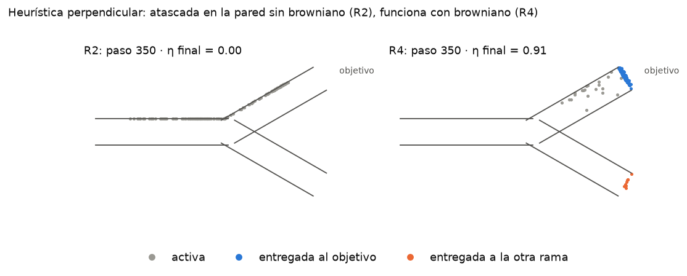
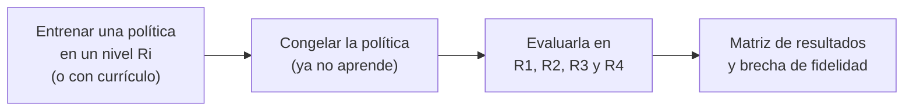

# TesisMIA_Magnetic-Nanoswarm_RL

**Generalización de políticas de aprendizaje por refuerzo ante diferentes niveles de fidelidad de simulación**

*Caso de estudio: direccionamiento de enjambres de nanopartículas magnéticas en bifurcaciones vasculares.*

[](https://www.python.org/downloads/)
[](https://gymnasium.farama.org/)

Tesis de la **Maestría en Ciencias con mención en Inteligencia Artificial**, Unidad de Posgrado de la Facultad de Ingeniería Industrial y de Sistemas, **Universidad Nacional de Ingeniería (UNI)**.

**Alumno:** Brayan Bruce Pérez Escobar

---

## Cómo leer este README

El documento sigue el orden en que se construye el proyecto. Cada paso responde una pregunta:

| Paso | Pregunta que responde |
|:---:|---|
| [1](#paso-1-la-pregunta-de-investigación) | ¿Qué se quiere averiguar? |
| [2](#paso-2-el-caso-de-estudio) | ¿En qué problema concreto se estudia? |
| [3](#paso-3-los-cuatro-niveles-de-fidelidad) | ¿Qué significa "nivel de fidelidad"? |
| [4](#paso-4-el-agente-qué-ve-qué-hace-y-qué-gana) | ¿Cómo se plantea como problema de aprendizaje por refuerzo? |
| [5](#paso-5-los-experimentos) | ¿Qué experimentos se hacen? |
| [6](#paso-6-cómo-se-mide) | ¿Cómo se decide qué funcionó mejor? |
| [7](#paso-7-plan-y-estado-actual) | ¿Qué está hecho y qué falta? |
| [8](#paso-8-cómo-ejecutarlo) | ¿Cómo reproduzco los resultados? |

El planteamiento completo está en [docs/Paper/Proyecto.pdf](docs/Paper/Proyecto.pdf) y la historia de cada decisión en [docs/bitacora.md](docs/bitacora.md).

---

## Paso 1. La pregunta de investigación

**En una frase:** ¿un controlador que aprendió en un simulador sigue funcionando si se lo prueba en un simulador más realista, o menos realista?

**Por qué importa.** En aprendizaje por refuerzo (RL) casi siempre se entrena en simulación, porque es barato y seguro, y después se usa la política en un entorno distinto. Ningún simulador es perfecto, así que la política siempre enfrenta un cambio de condiciones (*simulator mismatch*). Medany et al. (2025) lo observaron al controlar microrrobots: políticas entrenadas sin flujo fallaron al aparecer el flujo. Lo resolvieron con ajustes puntuales, pero no lo estudiaron de forma sistemática. Esta tesis sí lo hace.

**Preguntas de investigación:**

1. **Núcleo.** ¿Cómo varía el desempeño de una política cuando se entrena en un nivel de fidelidad y se evalúa en otro?
2. **Hipótesis principal.** Un currículo que entrena de lo simple a lo complejo (R1 → R2 → R3 → R4) produce políticas que generalizan mejor que entrenar en un único nivel.
3. **Extensión (opcional).** ¿Una política con un modelo interno del entorno (DreamerV3, *model-based*) es más robusta que una sin modelo (PPO, *model-free*)? Si DreamerV3 resulta demasiado costoso, la tesis queda completa con 1 y 2.

> El aporte es de **inteligencia artificial** (generalización en RL). La física es el laboratorio donde se hace el experimento, no el objeto de estudio.

## Paso 2. El caso de estudio

**La tarea.** Un enjambre de $N = 200$ nanopartículas magnéticas entra por un vaso sanguíneo que se divide en dos ramas (una bifurcación en Y). Una fuerza externa de control, idealizada, aplica la misma fuerza a todas las partículas. El agente decide en cada instante hacia dónde y con qué intensidad empujar, con el objetivo de que **la mayor fracción posible del enjambre salga por la rama objetivo** (la superior).



*Enjambre en la bifurcación en Y con flujo estacionario (R2) y con flujo pulsátil y browniano (R4).*

**Por qué este caso sirve para la pregunta.** El mismo problema se puede simular con física más o menos completa, añadiendo un fenómeno a la vez. Eso permite controlar exactamente qué cambia entre un simulador y otro.

**Dónde se simula.** En dos etapas:

| Etapa | Geometría | Para qué |
|---|---|---|
| **1 (actual)** | Bifurcación en Y en 2D con flujo analítico | Todos los experimentos de la tesis. Es rápida y permite muchas repeticiones |
| **2 (al final)** | 1–2 anatomías reales del Vascular Model Repository, con flujo calculado en SimVascular | Comprobar que las conclusiones se sostienen con geometría y flujo realistas |

## Paso 3. Los cuatro niveles de fidelidad

Cada nivel agrega un fenómeno físico al anterior:

| Nivel | Qué incluye | Qué agrega respecto al anterior |
|:---:|---|---|
| **R1** | Sin flujo | — (solo la fuerza de control mueve las partículas) |
| **R2** | Flujo estacionario | La sangre arrastra a las partículas, siempre igual |
| **R3** | Flujo pulsátil | La sangre late: acelera y frena con el pulso |
| **R4** | Flujo pulsátil + movimiento browniano | Las partículas además tiemblan al azar |

R1 es el simulador más simple y R4 el más realista. Las definiciones están congeladas: no cambian durante los experimentos.

**Ejemplo real, del Sprint 1.** Una regla fija que empuja las partículas hacia la pared de la rama objetivo entrega **0 %** del enjambre en R2 y **88 %** en R4. La misma estrategia funciona o fracasa según el simulador. Esta tesis mide ese efecto con políticas que aprenden. Detalle en [docs/eda_baseline.md](docs/eda_baseline.md).

## Paso 4. El agente: qué ve, qué hace y qué gana

Un problema de RL se define por lo que el agente **observa**, las **acciones** que puede tomar y la **recompensa** que recibe.

**4.1 Qué ve (observación).** Un vector de 11 números que resume el estado del enjambre:

| Variables | Significado |
|---|---|
| Centroide $(x, y)$ | Dónde está el centro del enjambre, medido desde la bifurcación |
| Dispersión $(x, y)$ | Qué tan esparcido está el enjambre |
| Fracciones entregadas | Qué parte salió por la rama objetivo, por la otra rama, y cuánta sigue en el vaso |
| Fase del pulso $(\sin\varphi, \cos\varphi)$ | En qué momento del latido está la sangre |
| Acción anterior $(x, y)$ | Hacia dónde empujó el paso previo |

**4.2 Qué hace (acción).** Elige la dirección e intensidad de la fuerza de control, $a_t \in [-1, 1]^2$, con norma máxima 1:

$$
\mathbf{F}_t = \frac{a_t}{\max(1, \lVert a_t \rVert_2)}
$$

**4.3 Cómo se mueven las partículas.** Cada partícula se mueve por la suma de tres efectos:

$$
\Delta\mathbf{x}_i = \Big[\underbrace{\mathbf{u}(\mathbf{x}_i, t)}_{\text{arrastre de la sangre}} + \underbrace{F_{\max}\,\mathbf{F}_t}_{\text{fuerza de control}}\Big]\Delta t + \underbrace{\sqrt{2D\,\Delta t}\;\boldsymbol{\xi}_i}_{\text{temblor browniano}}
$$

El arrastre vale cero en R1 y el temblor solo existe en R4. Las paredes rebotan las partículas, y cada partícula que sale por el extremo de una rama se cuenta en esa rama. El diseño completo está en [docs/diseno_entorno.md](docs/diseno_entorno.md).

**4.4 Qué gana (recompensa).** Puntos por acercar el enjambre a la rama objetivo y por cada partícula entregada; castigo por las partículas que se van a la otra rama y por gastar fuerza:

$$
r_t = w_p\,\Delta \bar{d} + w_e\,\Delta \eta_{\text{obj}} - w_m\,\Delta \eta_{\text{otras}} - w_u \lVert a_t \rVert_2^2
$$

Pesos vigentes, corregidos en el Sprint 2: $w_p = 0.1$, $w_e = 1$, $w_m = 0.5$ y $w_u = 0.0001$. Con los pesos originales la recompensa se podía "engañar": daba puntos por acercar partículas que nunca llegaban.

**4.5 Episodio.** Empieza con el enjambre en la entrada del vaso y termina cuando salió el 95 % del enjambre o se alcanzan 800 pasos.

**4.6 Parámetros físicos vigentes (entorno v0.2).**
- Magnitud máxima de la fuerza de control $F_{\max} = 0.3$ (fija), expresada como velocidad relativa a la de la sangre. La fuerza es idealizada: no se modela qué la produce.
- Radio de partícula de 0.05 veces el ancho del vaso.
- Pulso de ±90 % con período 20.

La justificación de cada valor está en el [informe del Sprint 2](notebooks/sem5_avance.ipynb) y en [docs/diseno_entorno.md](docs/diseno_entorno.md).

## Paso 5. Los experimentos



**5.1 Matriz de evaluación cruzada (núcleo).** Se entrenan cuatro políticas con PPO, una por nivel (πR1, πR2, πR3, πR4). Cada una se evalúa en los cuatro niveles. El resultado es una tabla de 4 × 4:

| Entrenada en ↓ / Evaluada en → | R1 | R2 | R3 | R4 |
|---|:---:|:---:|:---:|:---:|
| πR1 | **en casa** | → más realista | → más realista | → más realista |
| πR2 | ← más simple | **en casa** | → más realista | → más realista |
| πR3 | ← más simple | ← más simple | **en casa** | → más realista |
| πR4 | ← más simple | ← más simple | ← más simple | **en casa** |

La **brecha de fidelidad** mide cuánto cae el desempeño cuando la política sale de su nivel:

$$
\text{Gap}(i \to j) = \eta(\pi_{R_i} \text{ evaluada en } R_i) - \eta(\pi_{R_i} \text{ evaluada en } R_j)
$$

*Ejemplo:* si πR1 entrega 90 % en R1 y 40 % en R4, su brecha hacia R4 es de 50 puntos.

La matriz responde: ¿cuánto se degrada PPO?, ¿en qué dirección?, ¿entrenar en un nivel simple sirve para uno realista?, ¿y al revés?

**5.2 Currículo de fidelidad (hipótesis principal).** Una quinta política se entrena pasando por los niveles en orden, como en el colegio: primero lo fácil.

1. Empieza a entrenar en R1.
2. Pasa al siguiente nivel cuando su η en validación supera un umbral τ en 3 evaluaciones seguidas, o cuando agota el tope de entrenamiento de ese nivel (para que nunca se quede atascada).
3. Repite hasta terminar en R4.

Para que la comparación sea justa, usa el **mismo presupuesto total de entrenamiento** que las políticas de un solo nivel. El umbral τ y el tope se fijan en el piloto.

**Criterio de éxito:** el currículo gana si su η promedio en R1–R4 es mayor que el de πR4, la política entrenada solo en el nivel final.

**5.3 PPO frente a DreamerV3 (extensión).** Se repite la matriz con DreamerV3 (Hafner et al., 2025), que aprende un modelo interno del entorno, y se compara con PPO (Schulman et al., 2017), que no lo tiene.

**Referencias de comparación.** En todos los experimentos se reportan también políticas sin aprendizaje: no empujar (el reparto natural del flujo), empujar al azar y dos reglas geométricas fijas.

## Paso 6. Cómo se mide

**Métrica principal: eficiencia de direccionamiento**

$$
\eta = \frac{N_{\text{obj}}}{N}
$$

Es la fracción del enjambre que llegó a la rama objetivo: 1 significa que llegaron todas y 0 que no llegó ninguna.

**Métricas secundarias:**

| Métrica | Qué indica |
|---|---|
| Fracción perdida en otras ramas | Cuánto del enjambre se desvió |
| Tiempo de tránsito | Cuánto tarda el enjambre en llegar |
| Esfuerzo de control | Cuánta fuerza de control se aplicó |
| Eficiencia muestral | Qué tan rápido aprende la política (área bajo la curva de aprendizaje) |
| Estabilidad entre semillas | Si el resultado se repite al entrenar de nuevo con otra semilla |

El retorno acumulado (la suma de recompensas) se usa solo como diagnóstico, no como resultado.

**Estadística.** Cada configuración se entrena con varias semillas. Se reporta la media intercuartílica (IQM) con intervalos de confianza por *bootstrap* (Agarwal et al., 2021), porque en RL los resultados varían mucho de una semilla a otra.

## Paso 7. Plan y estado actual

| # | Etapa | Qué se hace | Estado |
|:---:|---|---|:---:|
| 1 | **Sprint 1: entorno y EDA** | Entorno mínimo v0.1, políticas de referencia y análisis exploratorio ([informe](docs/eda_baseline.md)) | Hecho |
| 2 | **Sprint 2: arreglar el simulador** | Tres correcciones, una por experimento (ver abajo) ([informe](notebooks/sem5_avance.ipynb)) | Hecho |
| 3 | **Piloto** | 3 semillas, una geometría, entrenamiento corto: PPO en R1–R4 y currículo simple | Pendiente |
| 4 | **Experimento completo** | PPO por nivel, PPO con currículo y matriz de evaluación cruzada | Pendiente |
| 5 | **Extensión** | DreamerV3, si el costo medido en el piloto lo permite | Pendiente |
| 6 | **Etapa 2** | Comprobación en anatomías reales con SimVascular | Pendiente |

**Sprint 2 en detalle.** El EDA encontró tres fallas que se corrigieron antes de entrenar. Se aplicó una corrección por variante, comparando cada una con la anterior con las mismas semillas. Los resultados son con semillas de reporte, nunca usadas para decidir:

| Variante | Cambio | Problema que resuelve | Resultado |
|---|---|---|---|
| Baseline | Entorno v0.1 | — | — |
| Var1 | Recompensa corregida | La recompensa se podía "engañar" | Correlación recompensa–η de 0.72 a 0.98 en R2 |
| Var2 | + radio de partícula | Las partículas se pegaban a la pared de forma irreal | η de la heurística perpendicular en R2: de 0.00 a 0.95 |
| Var3 | + pulso fuerte y lento | R3 daba los mismos resultados que R2 | No cumple con heurísticas: R3 sigue igual a R2; se verifica con PPO en el piloto |

**El piloto no busca probar la hipótesis.** Verifica que PPO aprende, que los niveles son realmente distintos, que el currículo avanza, que la recompensa acompaña a η y que el costo de cómputo es viable.

## Paso 8. Cómo ejecutarlo

Requisitos: Python 3.10 o superior. Los comandos son para Windows PowerShell.

**1. Instalar** (una sola vez):

```powershell
python -m venv .venv
.\.venv\Scripts\Activate.ps1
pip install -r requirements.txt
pip install -e . --no-deps
```

**2. Ver el informe del sprint actual (recomendado).** Abrir [notebooks/sem5_avance.ipynb](notebooks/sem5_avance.ipynb) en VS Code o Jupyter y ejecutar *Run All* (~10 min). El notebook explica cada paso y recalcula todos los resultados. Requiere además `pip install ipykernel`.

**3. O evaluar sin el notebook** las políticas de referencia en R1–R4:

```powershell
python scripts/evaluate.py --all              # baseline + 3 variantes del Sprint 2 (~6 min)
python scripts/evaluate.py --variant var3     # solo el entorno resultante
```

Cada variante genera:
- `logs/metrics_sprint2_<variante>.txt`: configuración, versiones, η de cada política en cada nivel con IC 95 %, métricas secundarias y alineación recompensa–η.
- `results/tables/episodes_sprint2_<variante>.csv`: una fila por episodio.

**Reproducibilidad.** Las semillas están separadas en dos particiones: **ajuste** (5000–5019), para tomar decisiones, y **reporte** (9000–9029), solo para los resultados. Todas las políticas usan las mismas semillas. Cada log guarda la fecha, el commit de git, las versiones de los paquetes y la configuración completa. El EDA del Sprint 1 se reproduce con `python scripts/eda.py`.

### Mapa del repositorio

| Carpeta | Contenido |
|---|---|
| `src/nanoswarm/envs/` | El entorno: geometría y dinámica, observación, recompensa |
| `src/nanoswarm/baselines/` | Políticas de referencia (aleatoria y heurísticas geométricas) |
| `src/nanoswarm/agents/`, `curriculum.py` | PPO, DreamerV3 y currículo (por implementar) |
| `scripts/` | Evaluación, EDA y entrenamiento |
| `logs/`, `results/` | Métricas, tablas y figuras generadas por los scripts |
| `docs/` | Planteamiento, bitácora de decisiones, diseño del entorno e informes de cada sprint |
| `cfd/`, `data/`, `validation/` | Reservadas para la etapa 2 (SimVascular) |

## Referencias

- Agarwal, R., Schwarzer, M., Castro, P. S., Courville, A., y Bellemare, M. G. (2021). Deep reinforcement learning at the edge of the statistical precipice. *Advances in Neural Information Processing Systems*, 34, 29304–29320.
- Bengio, Y., Louradour, J., Collobert, R., y Weston, J. (2009). Curriculum learning. En *Proceedings of the 26th International Conference on Machine Learning* (pp. 41–48).
- Hafner, D., Pasukonis, J., Ba, J., y Lillicrap, T. (2025). Mastering diverse control tasks through world models. *Nature*, 640, 647–653.
- Medany, M., Piglia, L., Achenbach, L., Mukkavilli, S. K., y Ahmed, D. (2025). Model-based reinforcement learning for ultrasound-driven autonomous microrobots. *Nature Machine Intelligence*, 7, 1076–1090. https://doi.org/10.1038/s42256-025-01054-2
- Raffin, A., Hill, A., Gleave, A., Kanervisto, A., Ernestus, M., y Dormann, N. (2021). Stable-Baselines3: Reliable reinforcement learning implementations. *Journal of Machine Learning Research*, 22(268), 1–8.
- Schulman, J., Wolski, F., Dhariwal, P., Radford, A., y Klimov, O. (2017). Proximal policy optimization algorithms. *arXiv preprint arXiv:1707.06347*.
- Towers, M., et al. (2024). Gymnasium: A standard interface for reinforcement learning environments. *arXiv preprint arXiv:2407.17032*.
- Updegrove, A., Wilson, N. M., Merkow, J., Lan, H., Marsden, A. L., y Shadden, S. C. (2017). SimVascular: An open source pipeline for cardiovascular simulation. *Annals of Biomedical Engineering*, 45(3), 525–541.
- Wilson, N. M., Ortiz, A. K., y Johnson, A. B. (2013). The vascular model repository: A public resource of medical imaging data and blood flow simulation results. *Journal of Medical Devices*, 7(4), 040923.
